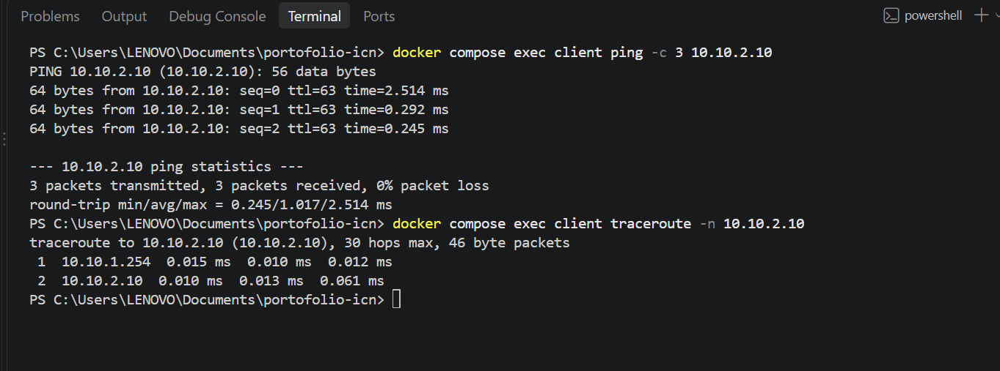
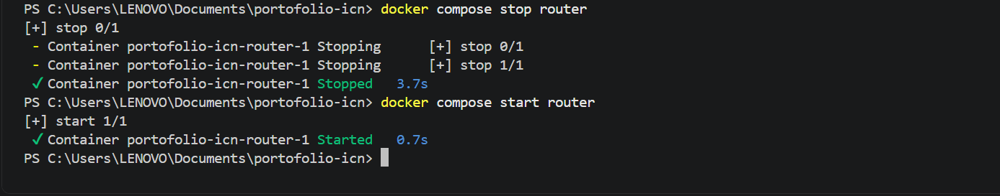
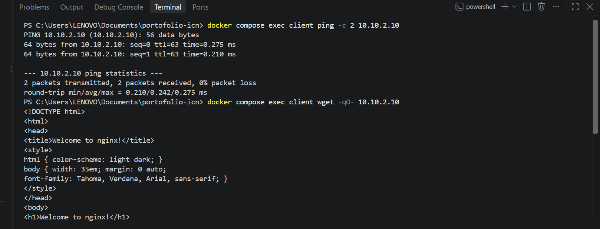
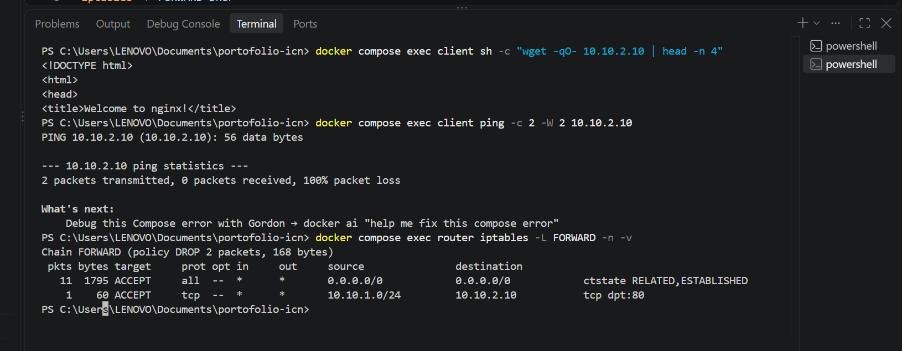

# Virtual Network Infrastructure Lab

Simulasi jaringan multi-subnet dengan router Linux dan firewall iptables, dibangun dengan Docker Compose di laptop sendiri. Proyek belajar untuk memahami bagaimana paket berjalan antar jaringan.

## Topologi

| Komponen | IP | Jaringan |
|---|---|---|
| client | 10.10.1.10 | net_a (10.10.1.0/24) |
| router | 10.10.1.254 dan 10.10.2.254 | net_a dan net_b |
| server (Nginx) | 10.10.2.10 | net_b (10.10.2.0/24) |

Client dan server berada di subnet berbeda, jadi semua lalu lintas harus lewat router. Router adalah container Alpine dengan `ip_forward=1`.

## Cara menjalankan

```
docker compose up -d
docker compose cp router/firewall.sh router:/firewall.sh
docker compose exec router sh /firewall.sh
```

Tunggu sekitar 20 detik setelah `up` karena router memasang iptables dulu.

## Hasil

**1. Routing antar subnet** (`ttl=63` menandakan paket melewati satu router)



**2. Router dimatikan, ping gagal (100% loss), bukti lalu lintas lewat router**



**3. Sebelum firewall: ping dan web tembus**



**4. Sesudah firewall: web (port 80) jalan, ping diblokir**



## Aturan firewall (`router/firewall.sh`)

- Default policy `FORWARD DROP`
- Izinkan balasan koneksi yang sudah berjalan (`ESTABLISHED,RELATED`)
- Izinkan client ke server hanya TCP port 80

## Catatan

- Aturan iptables hilang jika container router dibuat ulang, jadi skrip dijalankan lagi.
- Jaringan tidak memakai `internal: true` (lihat `docs/notes.md`), sehingga container tetap punya jalur keluar bawaan Docker. Firewall di lab ini hanya mengatur lalu lintas antar subnet lewat router.

## Rencana pengembangan

DNS internal, NAT, dan pembagian subnet dengan VLSM.